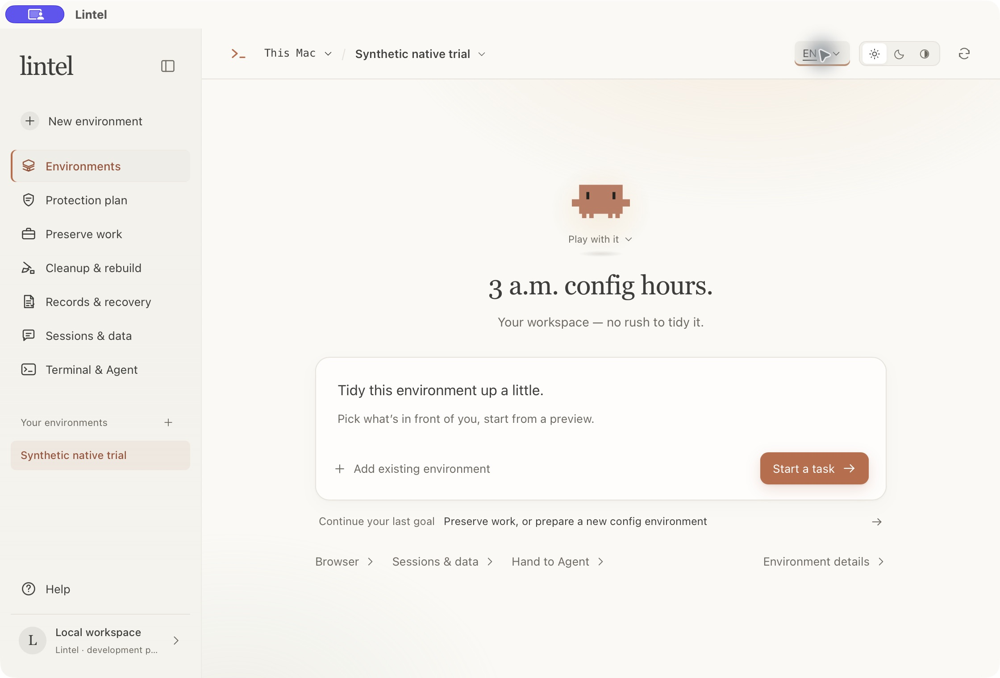
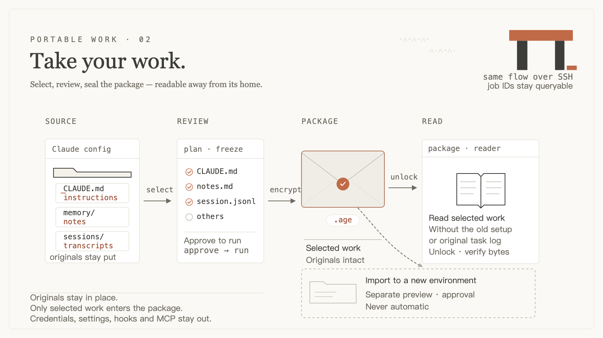

# Lintel

[简体中文](README.md) · English · [Documentation](docs/index.en.md) · [Website](https://lintel.page/en/)


**Manage Claude Code environments. Keep your work portable.**

Lintel provides a macOS app and a standalone CLI for reviewing configuration and optional outbound traffic, preserving instructions and sessions in encrypted archives, cleaning or rebuilding environments, and managing specific browser profiles and SSH hosts. The app and CLI share an execution core: review the target and changes before modifying it, inspect the result afterwards, and preserve later edits when restoring settings.

**The 0.1.1 developer Preview is published.** Download the Apple Silicon macOS App manually from the [GitHub prerelease](https://github.com/IndelibleVivi/lintel-cc/releases/tag/v0.1.1), and read the paired INSTALL notes and SHA256SUMS first. This release repairs the App resource-sealing defect in 0.1.0. All four public assets were downloaded and checked, and the App inside the new DMG passed strict signature verification. It has a complete ad-hoc signature, **no Developer ID, Apple notarization or updater feed**; first launch may require a per-App Open Anyway confirmation under System Settings → Privacy & Security. The old DMG/tag remain for historical verification; the CLI retains the original candidate downloads below. See [App installation](docs/app-updates.en.md) and [current status (Chinese)](docs/current-state.md) for exact source and acceptance scope.

The current reliability and bounded-history changes on `main` are unreleased. The public App remains 0.1.1 and the independent CLI remains 0.1.0. Source checks do not establish a new candidate, a native cold build, a verified new DMG, clean-Mac installation or a Release.

[First use](docs/start-here.en.md) · [Choose a task](docs/operator-guide.en.md) · [Use with an agent](docs/agents.en.md) · [Architecture](docs/architecture.en.md)



A real WebKit capture of the local unsigned candidate, using synthetic data. See [visual provenance and scope](assets/preview/asset-index.json).

## Start with your goal

| Your goal | What Lintel provides | Guide |
| --- | --- | --- |
| Reduce outbound traffic while keeping needed features | Protection presets, individual settings, a controlled proxy and egress tests | [Protection](docs/operator-guide.en.md#protect) |
| Preserve work or prepare a new environment | Exact selection of instructions, memory and sessions; encrypted archives, independent reading and selective import | [Work preservation](docs/operator-guide.en.md#work) |
| Repair local login, clean state or retire an environment | A preview of exact file and authentication scope; required preservation before deletion | [Cleanup](docs/operator-guide.en.md#cleanup) |
| Manage one browser profile | Extension/host pairing, profile permissions and site state | [Browser](docs/browser.en.md) |
| Operate an SSH host from a Mac or CLI | Verify the remote runner, execute on the target host, query the original task after disconnecting | [Remote](docs/remote.en.md) |
| Retrieve results or restore settings and services | Original task records, drift checks, field-level restore and restoration of explicitly bound systemd services | [Recovery](docs/operator-guide.en.md#recovery) |

The app supports Simplified Chinese/English and Day/Night/System themes. Clawd, character landscapes and small interactions add a playful layer without requiring a chat model. Interface animation, logo cursor and terminal cursor have independent local switches; only the logo blinks by default, and system reduced motion takes priority. The orange `>_` left of the host opens an inline display of the exact configuration path and environment ID.

## Build and try locally

<a id="local-build-and-trial"></a>

### Explore the interface

With Git, Rust stable and Node.js/npm compatible with the repository dependencies:

```sh
git clone https://github.com/IndelibleVivi/lintel-cc.git
cd lintel-cc
cargo build -p lintel-runner --locked
cd apps/desktop
npm ci
npm run dev:synthetic
```

Open the local URL printed in the terminal. This entry uses the real CLI with a fresh synthetic HOME/state and a visibly labelled test space. It is a browser-based development trial; the native macOS app is built separately. The temporary directory is retained for inspection. Personal logins and browser profiles are not used.

In Work preservation, select the synthetic instructions and memory, preview an archive-only task, review the scope, approve it and read the archive from the original result. The source material is kept and no new configuration environment is created. See [First use](docs/start-here.en.md) for steps, expected results and native app builds.

### Use only the CLI, or hand a task to an agent

In another terminal at the repository root, the CLI needs no Node, Tauri or installed app:

```sh
cargo build -p lintel-runner --locked
./target/debug/lintel version --json
./target/debug/lintel context --json
./target/debug/lintel tasks --json
./target/debug/lintel capabilities --json
```

These static entry points describe the executable, context and interfaces. Continue with the [Agent CLI guide](docs/agents.en.md) to choose a target, plan and execute. The [complete CLI trial](docs/quickstart.en.md) provides a synthetic archive journey with byte-level checks. Linux uses the standalone CLI/runner without a desktop environment. The current three-platform standalone CLI candidate is `0.1.0-candidate-fcae6cb1efb5`, published in the [v0.1.0 Preview](https://github.com/IndelibleVivi/lintel-cc/releases/tag/v0.1.0). Archive names retain their original candidate identity; both Linux architectures are experimental. A CLI built from source is independent of the App candidate.

## From originals to your next session



Select the originals you need, review the frozen plan, and approve encrypted preservation. The source files remain intact. Carry the package with your chosen file-transfer tool and open it in independent state. Importing into an environment is a separate decision; opening the package never imports it or starts Claude automatically.

Local file tasks run in the local core. SSH requests go to the target host’s runner and core. The browser extension operates its own profile; the controlled proxy handles connections routed through it. See the [architecture and source map](docs/architecture.en.md) for those boundaries.

## Data and scope

Lintel requires no account of its own, model key or online activation. Analytics, crash uploads and remote font requests are off by default. Explicit egress tests contact the displayed echo services and reveal the tested exit IP to them.

Identify the **host, configuration root and browser profile** before acting. Select the project working directory separately from the Claude configuration root. A new root separates local state; a proxy controls connections passing through it. Neither establishes an OS sandbox or account isolation. Browser deletion is irreversible; settings restoration checks for subsequent edits. Feature-specific constraints live in their guides, with runtime coverage in [current status (Chinese)](docs/current-state.md).

Selective egress configuration currently covers the 27 fields recognized by the v5 rule. Ordinary App editing offers an action directly on each row, with explicit Bulk edit for only common applicable actions and a count for hidden selections. Three quick recipes retain non-secret intent and regenerate a plan on every run; a personal default whose intent differs is labelled from its actual choices. See [protection operations](docs/operator-guide.en.md#protect) and [desktop custom protection](docs/desktop.en.md#custom-protection).

On 10-20, the clean `fcae6cb` release WebKit app extracted from its DMG completed empty-workspace registration, exact three-file selection, one archive approval, quit/reopen and original-job lookup in a new synthetic HOME/state. The independent-file reader and the delivered CLI in another empty state read all three originals byte for byte. Native Chinese/English menus, themes, documentation links, the unconfigured-update message, game and CLI handoff were also exercised. Native configuration and residue edit/restore evidence remains scoped to the earlier `e822d74` build; two later configuration edits were retained. Personal authentication, production browsers, download/install on a clean Mac and Apple signing/notarization remain separately unverified. See [current state](docs/current-state.md) for the exact coverage.

## A glimpse of its world

[](https://lintel.page/media/lintel-intro.mp4)

[Watch the 20-second concept film](https://lintel.page/media/lintel-intro.mp4). Work, review and crossing the bridge are conceptual animation, with original music and locally generated English narration. This is separate from an App operation recording. See [production provenance](scripts/preview-film/README.md).

## Development and documentation

The [documentation hub](docs/index.en.md) separates first use, task guides and engineering references. [Core concepts](docs/concepts.en.md) explains targets, plans, original tasks and work packages. Use [Troubleshooting](docs/troubleshooting.en.md) when a result needs investigation.

Start engineering work with the [architecture/source map](docs/architecture.en.md), [Core / CLI](docs/core.en.md) and [protocol (Chinese)](contracts/protocol.md). List the shared verification entry points with:

```sh
python3 tests/verify.py --list
```

Choose checks relevant to the change using the [verification guide (Chinese)](docs/verification.md). Running without arguments selects the full synthetic default group; it is not a documentation-only quick check.

Report issues through [GitHub Issues](https://github.com/IndelibleVivi/lintel-cc/issues), including version/source, target, steps and actual result. Use synthetic examples and omit credentials or unredacted work material.

Lintel is not affiliated with Anthropic. Clawd and third-party dependencies retain their respective rights. Source publication and a formal release are tracked separately.

Licensing: this is a source-available Preview, not OSI open source. Original functional code uses [SUL-1.0](LICENSE); original documentation and independent original diagrams use [CC BY-NC-SA 4.0](LICENSE-DOCUMENTATION). Brand, Clawd and unverified assets are excluded; third parties retain their terms. See [scope and transition](LICENSING.md).
