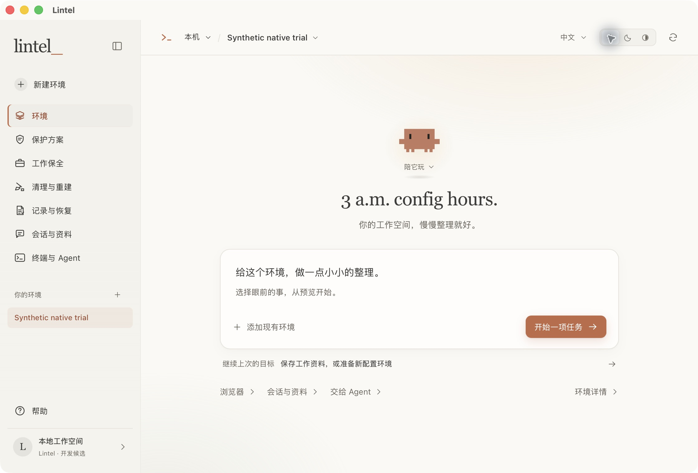
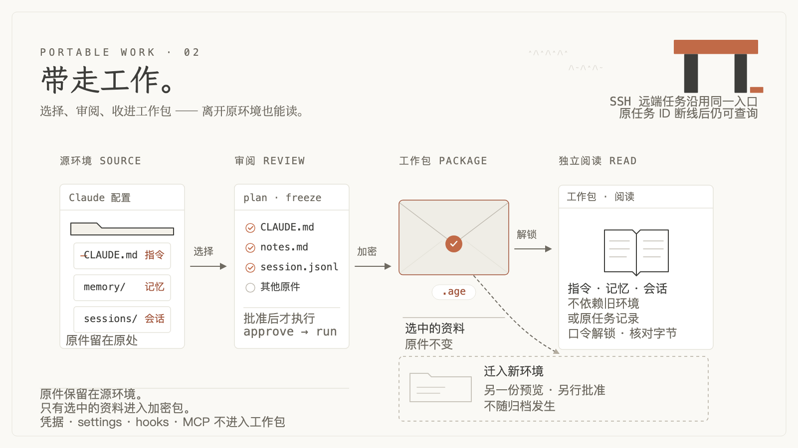

# Lintel

简体中文 · [English](README.en.md) · [使用文档](docs/index.md) · [官网](https://lintel.page/)


**管理 Claude Code 的环境，把工作资料带得走。**

Lintel 提供 macOS App 与独立 CLI，帮助你审阅配置与可选外发、加密保全指令和会话、清理重建环境，以及管理具体浏览器 profile 和 SSH 主机。App 与 CLI 共用执行核心；修改前查看目标与变化，执行后核对结果，需要恢复时保留后续编辑。

**当前为 0.1.0 Preview。** 可以从公开源码试用；尚无公开 Release 下载、正式签名或已启用的更新 feed。最新本地 macOS arm64 发行准备候选是 10-19 的 clean `fcae6cb`，已包含客户端控制、逐项／批量保护编辑和新版侧栏图标。已从只读 DMG 取出，包内资源已核对，未安装到 Applications；各版本的 native 行为证据分别记录。准确来源、平台与验收范围见[当前状态](docs/current-state.md)。

[第一次使用](docs/start-here.md) · [按目标操作](docs/operator-guide.md) · [交给 Agent](docs/agents.md) · [架构](docs/architecture.md)

<a id="现在可以做什么"></a>



上图为本地未签名候选的真实 WebKit 界面，数据为合成示例；[配图来源与范围](assets/preview/asset-index.json)。

## 从眼前的目标开始

| 你想做什么 | Lintel 提供什么 | 从哪里进入 |
| --- | --- | --- |
| 减少外发，保留需要的功能 | 保护方案、逐项配置、受控代理通道与出口测试 | [保护方案](docs/operator-guide.md#protect) |
| 收好工作，或准备新环境 | 精确选择指令、记忆和会话；加密归档、独立阅读与选择性迁入 | [工作保全](docs/operator-guide.md#work) |
| 修复登录、清理旧状态、退役环境 | 按目标预览文件与认证处理范围；涉及删除时先完成所需保全 | [清理与重建](docs/operator-guide.md#cleanup) |
| 管理某个浏览器 profile | 配对扩展与本地 host，处理对应权限和站点状态 | [浏览器](docs/browser.md) |
| 从 Mac 或 CLI 操作 SSH 主机 | 核对远端 runner，在目标主机执行，断线后查询原任务 | [远程](docs/remote.md) |
| 找回结果，恢复配置或服务 | 原任务记录、变化检查、字段恢复与明确绑定的 systemd 服务恢复 | [记录与恢复](docs/operator-guide.md#recovery) |

App 支持简体中文／English 与 Day／Night／System。首页的 Clawd、字符风景和小彩蛋保留在工具之外的轻松一层；使用这些交互不需要聊天模型。界面动画、Logo 光标和终端光标各有本机开关，默认只保留 Logo 慢闪，系统减少动态优先。顶栏主机名左侧的橙色 `>_` 可向下展开准确配置路径与环境 ID。

## 本地构建与试用

### 先体验界面

准备 Git、Rust stable 和与仓库依赖兼容的 Node.js／npm，在终端运行：

```sh
git clone https://github.com/IndelibleVivi/lintel-cc.git
cd lintel-cc
cargo build -p lintel-runner --locked
cd apps/desktop
npm ci
npm run dev:synthetic
```

打开终端显示的本地地址。这个入口用真实 CLI 操作新建的合成 HOME／state，界面会显示“测试空间”；它是浏览器中的开发试用，原生 macOS App 另行构建。临时目录保留供检查，不使用你的个人登录或浏览器资料。

进入“工作保全”，选择合成指令和记忆，预览“只生成工作归档”，核对范围后批准，再从原任务结果打开归档阅读。这条路径保留源资料，不建立新配置环境。完整步骤、预期结果和原生 App 构建见[第一次使用](docs/start-here.md)。

### 只用 CLI 或交给 Agent

在另一个终端进入仓库根目录；CLI 不需要 Node、Tauri 或已安装 App：

```sh
cargo build -p lintel-runner --locked
./target/debug/lintel version --json
./target/debug/lintel context --json
./target/debug/lintel tasks --json
./target/debug/lintel capabilities --json
```

这些静态入口先说明当前 executable、上下文和接口。随后按 [Agent CLI 指南](docs/agents.md) 选择目标、生成计划并执行；要走完可逐字节核对的合成归档旅程，使用 [CLI 完整试用](docs/quickstart.md)。Linux 使用独立 CLI／runner，无需桌面环境。当前独立三平台 CLI 候选为 `0.1.0-candidate-fcae6cb1efb5`，没有正式下载链接；从源码构建的 CLI 不受 App 候选版本约束。

## 从原件到下一次工作



选择需要的原件，先看冻结计划，再批准加密保全。源资料保留，工作包可通过你选择的文件传输工具带走，在另一份独立 state 中打开阅读。迁入环境是另一次明确选择，打开包不会自动迁入或启动 Claude。

本机文件任务由本机 core 执行；SSH 请求交给目标主机的 runner 和 core。浏览器扩展操作它所属的 profile，受控代理只处理经过它的连接。[架构图与源码入口](docs/architecture.md)解释这些边界。

## 数据与边界

Lintel 无需自身账号、模型 key 或在线激活，默认不发送 analytics、崩溃报告或远程字体请求。主动出口测试会连接界面列出的回显服务，并向它们暴露本次出口 IP。

操作前认准**主机、配置目录、浏览器 profile**；项目工作目录与 Claude 配置目录分开选择。新配置目录提供本地状态分离，代理提供经过它的连接控制；两者都不能充当系统级沙箱或账户隔离证明。浏览器删除无法撤销，配置恢复会核对后续修改。具体功能的限制放在各自指南中，运行验收范围由[当前状态](docs/current-state.md)维护。

当前已接通的选择性外发配置使用 v5 规则识别的 27 个字段。App 普通编辑可直接在每行选动作，也可明确进入批量编辑；只提供共同适用的动作，并显示筛选之外选择的数量。三条快捷配方只保存非秘密意图，每次重新生成计划；与内置意图不同的个人默认按实际选择标注。详细边界在[保护方案操作](docs/operator-guide.md#protect)与[桌面自定义保护](docs/desktop.md#自定义保护)。

10-20 已用从 DMG 取出的 clean `fcae6cb` release WebKit，在新的合成 HOME／state 中完成空白登记、精确三件选择、一次批准归档、退出重开和原任务核对；独立文件入口与另一份空 state 的 CLI 均读回三份原文，字节一致。中英菜单、主题、文档链接、未配置更新提示、游戏和 CLI 交接也已实测。配置字段修改／恢复与残留清理／恢复的 native 证据属于先前的 `e822d74`，两处后续配置编辑保留。真实个人认证、正式浏览器、干净 Mac 下载首装及签名公证仍分别未验收；完整范围见[当前状态](docs/current-state.md)。

## 看一眼它的世界

[](https://lintel.page/media/lintel-intro.mp4)

[播放 20 秒概念短片](https://lintel.page/media/lintel-intro.mp4)。这是工作资料、审阅与过桥的概念动画，含原创音乐与本地生成的英文配音，不是 App 操作录像。[制作来源](scripts/preview-film/README.md)与真实界面截图分别维护。

## 开发与文档

[文档入口](docs/index.md)按首次使用、具体任务、工程参考组织内容。[基本概念](docs/concepts.md)解释目标、计划、原任务与工作包；遇到卡点可查[排错指南](docs/troubleshooting.md)。

开发者从[架构与源码地图](docs/architecture.md)、[Core / CLI](docs/core.md)和[协议](contracts/protocol.md)进入。统一验证入口：

```sh
python3 tests/verify.py --list
```

选择与改动相关的检查，方法见[验证指南](docs/verification.md)。无参数运行包含完整 synthetic 默认组，并非文档修改专用的快速检查。

反馈请提交到 [Issues](https://github.com/IndelibleVivi/lintel-cc/issues)，说明版本或来源、目标、步骤与实际结果；使用合成示例，不附凭据或未脱敏工作资料。

Lintel 与 Anthropic 无官方关联，Clawd 形象及第三方依赖保留各自权利。项目原创材料的公开复用许可尚待选定；源码公开与正式发行分别记录。
