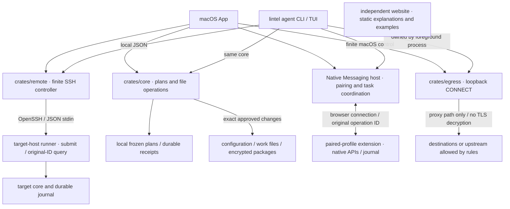

# Execution authority and state

[简体中文 (canonical)](architecture.md) · English · [Documentation](index.en.md)

This diagram shows call paths and execution ownership in the current source. It does not mean every platform or complete journey has been accepted. Runtime evidence and candidate status are in [current state (Chinese)](current-state.md); [SPEC (Chinese)](SPEC.md) retains the full target.

[View the editable SVG diagram](assets/architecture.svg) (Chinese labels). The SVG places local and target-host execution areas and independent channels on warm paper. The Mermaid diagram and this text own the semantics; the SVG preserves the same ownership and does not define capabilities independently. The SVG is best read at widths of about 900 px or more; use the explanation below in a smaller window.

`crates/operations` provides static core operations/schemas and strict field contracts for named and finite transports; it executes no side effects. Core owns local file operations, frozen plans and restoration for both App and CLI. The SSH controller transports only finite requests and saves original-task mappings; the target runner/core ACKs only after durable acceptance, and reconnect queries only the original ID. Cleanup proceeds through state backup/work archive → import into a new root → approved logout/file handling.

The browser host owns pairing and task coordination. The extension owns profile permissions, native operations and the execution journal. A real browser startup and separate approval are required to finish clear. The macOS CLI includes host control; the Linux runner explicitly reports the component unavailable. App and CLI each own their own network channel. The proxy proves only connections passing through it; it cannot prove that direct process egress is forcibly blocked.

A portable work ciphertext file can be handed over with a system transfer tool explicitly selected by the user. The target core can inspect and import it independently of the source inventory/job. File transfer is not an implicit task of the SSH controller.

The execution paths in the diagram concern environments, browsers and runners. Native `app_updates.rs` and the official Tauri updater own App updates: fixed feed → frozen candidate → download/signature verification → original update intent → installation/result readback → explicit restart. `activity.rs` excludes current App operations during installation/restart, and active proxies separately block them. This App-data record is independent of core jobs; uncertainty is never replayed. The current source has no release public key/feed configured. Actual Release and website activation remain separate; see [App updates](app-updates.en.md).

The website has no execution path to core, host, SSH controller or proxy. It shows local illustrations, synthetic reading examples and the shared Clawd game; reading examples are not real operations or task receipts.

The key states are `planned → accepted → executing → verifying → completed / partially_completed / failed / needs_reconciliation`. `accepted` is established only when the journal can be queried durably. Uncertain side effects query the original task and do not replay destructive actions; restoration depends on field ownership and current values.
