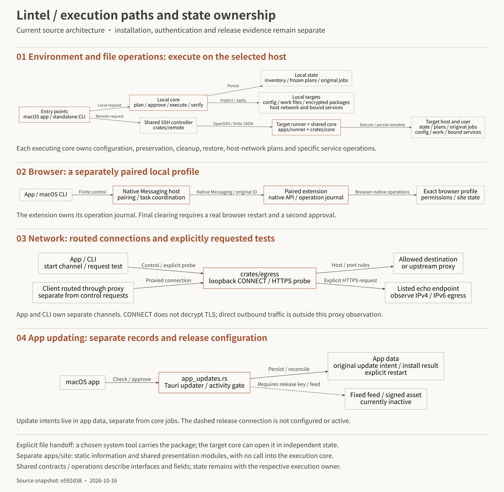

# Lintel architecture: execution paths and state ownership

[简体中文](architecture.md) · English · [Documentation](index.en.md)

This view answers three questions: where requests enter, who executes an operation, and who owns its result. It describes the source architecture; delivery and runtime evidence remain in [current status (Chinese)](current-state.md).

[Full SVG](assets/architecture.en.svg) · [PNG](assets/architecture.en.png) · [Mermaid source](assets/architecture.en.mmd)

On a phone, zoom the original image or read the four paths below. The README uses a [smaller overview](assets/architecture-overview.en.svg).

## Four execution paths

**Environment and file tasks.** The app's native request and standalone CLI call the same `crates/core`. The local core owns inventory, frozen plans, configuration/file operations, original task records and field restoration. Remote requests pass through shared `crates/remote` over OpenSSH with finite JSON requests to the target runner. The target core executes with its own state. The controller keeps task mappings but cannot declare remote completion itself. `crates/operations` defines interfaces and strict field contracts without executing file side effects.

**Browser.** The app and macOS CLI use a Native Messaging host for pairing and task coordination. The paired extension owns profile-native operations and its operation journal. Final browser clearing requires a real restart and a second approval. Switching SSH environments does not move this local browser path; the Linux runner does not provide local browser-host control.

**Network.** `crates/egress` implements loopback CONNECT channels and explicit HTTPS egress probes. App and CLI own separate channels. Client connections are covered by a channel only when routed through it. Configuration readback, observed proxy connections and IPv4/IPv6 tests provide distinct evidence. The core owns host-network plans and restoration: current macOS support includes IPv6 changes for explicitly selected services, while Linux provides read-only observation and tests. See [Network](network.en.md).

**App updates.** Native `app_updates.rs` and the Tauri updater handle candidate checks, download/signature verification, approved installation and explicit restart. Original update intents live in app data, separately from core jobs. The activity gate coordinates app operations against installation; active proxies block updating separately. There is no public Release download, formal signing or active release key/feed. `e822d74` is a local release-preparation candidate, not a public update source. The website may derive manual-download metadata only from a `lintel.app-release-public/1` record after public-byte verification; the source feed path does not establish activation.

`apps/site` independently presents documentation, artwork and the shared game. It has no execution call into the core, SSH controller or browser host. A work package can travel using an explicitly selected system file-transfer tool. The target core can unlock, inspect and selectively import it in independent state without the source job.

## Completion of a plan-based core task

`Generate/persist plan → review exact scope/hash → durable accepted → execute → verify`

Outcomes include `completed`, `partially_completed`, `failed` and `needs_reconciliation`. Query the original ID to track or reconcile; a query may persist reconciliation information but does not replay destructive actions. Restoration uses a separate reviewed plan, checking field ownership and current values.

This lifecycle describes plan-based core tasks. Session launch/resume uses dedicated requests and real-TTY execution; generic execute/submit does not accept those plans. Browser operations and app-update intents retain separate records rather than sharing one universal job lifecycle.

## Source map

| Area | Entry point |
| --- | --- |
| App UI and native dispatch | [`apps/desktop`](../apps/desktop), [`src-tauri/src/main.rs`](../apps/desktop/src-tauri/src/main.rs) |
| CLI/TUI, submit and interactive launch | [`apps/runner/src/main.rs`](../apps/runner/src/main.rs) |
| Plans, inventory, files, packages, task records and restore | [`crates/core`](../crates/core) |
| Static operations/schema and field validation | [`crates/operations`](../crates/operations) |
| Shared SSH controller | [`crates/remote`](../crates/remote) |
| Extension and Native Messaging host | [`extensions/browser`](../extensions/browser) |
| CONNECT, egress probes and controlled rule tests | [`crates/egress`](../crates/egress) |
| App updating and activity exclusion | [`app_updates.rs`](../apps/desktop/src-tauri/src/app_updates.rs), [`activity.rs`](../apps/desktop/src-tauri/src/activity.rs) |
| User task navigation and operation mapping | [`contracts/task-catalog.json`](../contracts/task-catalog.json) |
| Website and shared verification entry point | [`apps/site`](../apps/site), [`tests/verify.py`](../tests/verify.py) |

`platform/ssh` retains a compatibility subset for the original Python caller; shared new remote functionality belongs to the Rust controller. Continue with [Core / CLI](core.en.md) and the [protocol (Chinese)](../contracts/protocol.md) for protocol and storage details.

```mermaid
flowchart TB
  subgraph execution["01  Environment and file operations: execute on the selected host"]
    direction LR
    entry["Entry points<br/>macOS app / standalone CLI"]
    local["Local core<br/>plan / approve / execute / verify"]
    localstate["Local state<br/>inventory / frozen plans / original jobs"]
    targets["Local targets<br/>config / work files / encrypted packages<br/>host network and bound services"]
    controller["Shared SSH controller<br/>crates/remote"]
    runner["Target runner + shared core<br/>apps/runner + crates/core"]
    remoteowned["Target host and user<br/>state / plans / original jobs<br/>config / work / bound services"]
    entry -->|"Local request"| local
    entry -->|"Remote request"| controller
    local -->|"Persist"| localstate
    local -->|"Inspect / apply"| targets
    controller -->|"OpenSSH / finite JSON"| runner
    runner -->|"Execute / persist remotely"| remoteowned
  end
  subgraph browser["02  Browser: a separately paired local profile"]
    direction LR
    browserentry["App / macOS CLI"]
    host["Native Messaging host<br/>pairing / task coordination"]
    extension["Paired extension<br/>native API / operation journal"]
    profile["Exact browser profile<br/>permissions / site state"]
    browserentry -->|"Finite control"| host
    host -->|"Native Messaging / original ID"| extension
    extension -->|"Browser-native operations"| profile
  end
  subgraph network["03  Network: routed connections and explicitly requested tests"]
    direction LR
    netentry["App / CLI<br/>start channel / request test"]
    client["Client routed through proxy<br/>separate from control requests"]
    egress["crates/egress<br/>loopback CONNECT / HTTPS probe"]
    destination["Allowed destination<br/>or upstream proxy"]
    echo["Listed echo endpoint<br/>observe IPv4 / IPv6 egress"]
    netentry -->|"Control / explicit probe"| egress
    client -->|"Proxied connection"| egress
    egress -->|"Host / port rules"| destination
    egress -->|"Explicit HTTPS request"| echo
  end
  subgraph updates["04  App updating: separate records and release configuration"]
    direction LR
    updateentry["macOS app"]
    updater["app_updates.rs<br/>Tauri updater / activity gate"]
    intent["App data<br/>original update intent / install result<br/>explicit restart"]
    feed["Fixed feed / signed asset<br/>currently inactive"]
    updateentry -->|"Check / approve"| updater
    updater -->|"Persist / reconcile"| intent
    updater -.->|"Requires release key / feed"| feed
  end
  transfer["Explicit system file transfer · work package"]
  website["Separate website · no execution connection"]
```

Expand Mermaid for GitHub reading and editing

