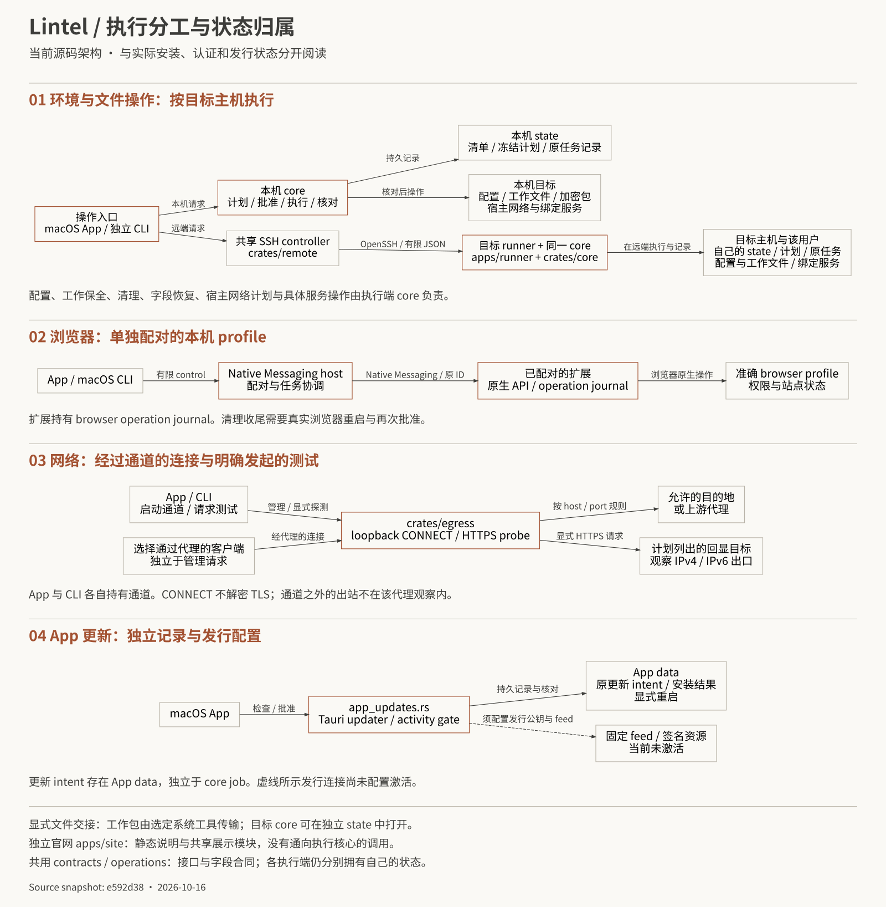

# Lintel 架构：执行分工与状态归属

简体中文 · [English](architecture.en.md) · [文档入口](index.md)

这张图回答三个问题：请求从哪里进入，操作由谁执行，结果保存在谁手里。它描述当前源码，运行与发行范围查[当前状态](current-state.md)。

[查看大图 SVG](assets/architecture.svg) · [PNG](assets/architecture.png) · [Mermaid 源](assets/architecture.mmd)

手机上可以放大原图，或直接阅读下面的四段执行说明。README 使用的是[简版总览](assets/architecture-overview.svg)。

## 四条执行路径

**环境与文件任务。** App 的 native request 和独立 CLI 调用同一 `crates/core`。本机 core 拥有环境清单、冻结计划、配置与文件操作、原任务记录和字段恢复。远端请求通过共享 `crates/remote`，以 OpenSSH 携带有限 JSON 请求到目标 runner；目标 core 使用自己的 state 执行与记录。controller 保存任务映射，但不替远端宣布操作完成。`crates/operations` 描述接口与严格字段合同，不执行文件副作用。

**浏览器。** App 和 macOS CLI 通过 Native Messaging host 管理配对与任务协调；已配对扩展拥有 profile 原生操作和 operation journal。浏览器清理的收尾需要真实重启与再次批准。切换 SSH 环境不会改变这条本机浏览器路径；Linux runner 不提供本机 browser-host control。

**网络。** `crates/egress` 提供 loopback CONNECT 通道和显式 HTTPS 出口测试实现。App 与 CLI 各自持有通道；客户端选择通过代理时，连接才受该通道规则约束。配置读回、代理连接观察、IPv4／IPv6 实测分别给出证据。宿主网络计划及恢复由 core 管理：当前 macOS 支持明确服务的 IPv6 配置操作，Linux 保留只读观察和测试。详细范围见[网络](network.md)。

**App 更新。** native `app_updates.rs` 与 Tauri updater 处理候选检查、下载验签、批准安装和明确重启；原更新 intent 留在 App data，独立于 core job。activity gate 管理 App 操作与更新的互斥，活跃代理另行阻止更新。当前没有公开 Release 下载、正式签名或已启用的发布公钥／feed；`e822d74` 是本地发行准备候选，不是公开更新源。官网只能依据已完成公开字节核对的 `lintel.app-release-public/1` 记录生成手工下载元数据；源码里的 feed 路径不等于已激活。

官网 `apps/site` 独立展示文档、插画和共享游戏，没有通向本机 core、SSH controller 或 browser host 的执行调用。工作包可以由用户明确选择的系统文件传输工具携带；目标 core 在独立 state 中解锁、检查和选择性迁入，不依赖源 job。

## 一次计划型 core 任务怎样完成

`生成并保存计划 → 审阅准确范围与 hash → 持久 accepted → 执行 → 核对结果`

最终结果可以是 `completed`、`partially_completed`、`failed` 或 `needs_reconciliation`。查询原 ID 用于追踪与核对，可能写入中断核对信息；它不重放破坏性动作。恢复另外生成计划，按字段归属及当前值核对后批准。

这段生命周期针对 core 计划型任务。会话 launch／resume 使用专用 request 与真实 TTY 执行入口；generic execute／submit 不接收这些计划。浏览器 operation 和 App 更新 intent 也分别保存，不能用一个通用 job 流程代替所有模块。

## 源码地图

| 你要理解或修改的部分 | 入口 |
| --- | --- |
| App 页面与 native 调度 | [`apps/desktop`](../apps/desktop)、[`src-tauri/src/main.rs`](../apps/desktop/src-tauri/src/main.rs) |
| CLI／TUI、submit、专用交互启动 | [`apps/runner/src/main.rs`](../apps/runner/src/main.rs) |
| 计划、环境、文件、工作包、任务记录与恢复 | [`crates/core`](../crates/core) |
| 静态 operation／schema 与字段校验 | [`crates/operations`](../crates/operations) |
| 共用 SSH controller | [`crates/remote`](../crates/remote) |
| 浏览器扩展与 Native Messaging host | [`extensions/browser`](../extensions/browser) |
| CONNECT、出口实测与通道规则测试 | [`crates/egress`](../crates/egress) |
| App 自身更新与活动互斥 | [`app_updates.rs`](../apps/desktop/src-tauri/src/app_updates.rs)、[`activity.rs`](../apps/desktop/src-tauri/src/activity.rs) |
| 用户任务导航与技术操作映射 | [`contracts/task-catalog.json`](../contracts/task-catalog.json) |
| 官网、统一验证入口 | [`apps/site`](../apps/site)、[`tests/verify.py`](../tests/verify.py) |

`platform/ssh` 保留原 Python caller 的兼容子集；新增共享远端能力由 Rust controller 拥有。协议与存储细节继续查 [Core / CLI](core.md)和[协议](../contracts/protocol.md)。

```mermaid
flowchart TB
  subgraph execution["01  环境与文件操作：按目标主机执行"]
    direction LR
    entry["操作入口<br/>macOS App / 独立 CLI"]
    local["本机 core<br/>计划 / 批准 / 执行 / 核对"]
    localstate["本机 state<br/>清单 / 冻结计划 / 原任务记录"]
    targets["本机目标<br/>配置 / 工作文件 / 加密包<br/>宿主网络与绑定服务"]
    controller["共享 SSH controller<br/>crates/remote"]
    runner["目标 runner + 同一 core<br/>apps/runner + crates/core"]
    remoteowned["目标主机与该用户<br/>自己的 state / 计划 / 原任务<br/>配置与工作文件 / 绑定服务"]
    entry -->|"本机请求"| local
    entry -->|"远端请求"| controller
    local -->|"持久记录"| localstate
    local -->|"核对后操作"| targets
    controller -->|"OpenSSH / 有限 JSON"| runner
    runner -->|"在远端执行与记录"| remoteowned
  end
  subgraph browser["02  浏览器：单独配对的本机 profile"]
    direction LR
    browserentry["App / macOS CLI"]
    host["Native Messaging host<br/>配对与任务协调"]
    extension["已配对的扩展<br/>原生 API / operation journal"]
    profile["准确 browser profile<br/>权限与站点状态"]
    browserentry -->|"有限 control"| host
    host -->|"Native Messaging / 原 ID"| extension
    extension -->|"浏览器原生操作"| profile
  end
  subgraph network["03  网络：经过通道的连接与明确发起的测试"]
    direction LR
    netentry["App / CLI<br/>启动通道 / 请求测试"]
    client["选择通过代理的客户端<br/>独立于管理请求"]
    egress["crates/egress<br/>loopback CONNECT / HTTPS probe"]
    destination["允许的目的地<br/>或上游代理"]
    echo["计划列出的回显目标<br/>观察 IPv4 / IPv6 出口"]
    netentry -->|"管理 / 显式探测"| egress
    client -->|"经代理的连接"| egress
    egress -->|"按 host / port 规则"| destination
    egress -->|"显式 HTTPS 请求"| echo
  end
  subgraph updates["04  App 更新：独立记录与发行配置"]
    direction LR
    updateentry["macOS App"]
    updater["app_updates.rs<br/>Tauri updater / activity gate"]
    intent["App data<br/>原更新 intent / 安装结果<br/>显式重启"]
    feed["固定 feed / 签名资源<br/>当前未激活"]
    updateentry -->|"检查 / 批准"| updater
    updater -->|"持久记录与核对"| intent
    updater -.->|"须配置发行公钥与 feed"| feed
  end
  transfer["显式系统文件传输 · 工作包"]
  website["独立官网 · 无执行连接"]
```

展开 Mermaid（用于 GitHub 阅读与后续编辑）

