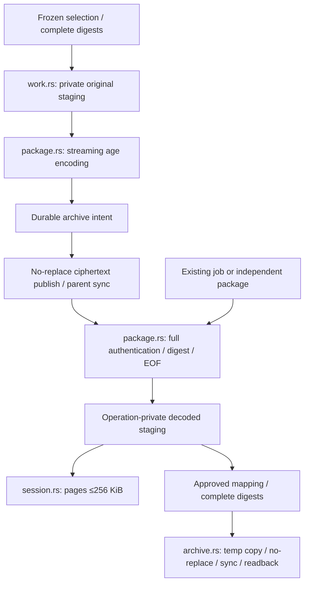

# Core and CLI

[简体中文 (canonical)](core.md) · English · [Documentation](index.en.md)

`crates/core` is the sole implementation of local environment inventory, plans, file operations, task journals and field restoration. GUI and `apps/runner` call the same `handle_request`. [SPEC (Chinese)](SPEC.md) retains the full target; this page describes current implementation only.

## Host-shared IPv4 / IPv6

`telemetry_catalog` returns the compiled [exact catalog](../contracts/telemetry-destinations.json) before runtime-path/state initialization and accepts only command. Named CLI/finite SSH share operations' static field contract. No plan/task/network request is created. Policy records nonessential-traffic update/feature-flag collateral; the original egress Proxy owns controlled tests. [Telemetry](telemetry.en.md) defines observation boundaries. Independent native `app_updates.rs` owns App updates outside Claude mutation plans; original update intent lives in App data. See [App updates](app-updates.en.md).

`network.rs` owns offline observation, finite-probe metadata/baselines and exact macOS IPv6 plans/approval/journal/restoration; egress probe is the sole HTTPS-byte implementation. `network_inspect`, `network_probe`, `plan_network_ipv6`, `plan_network_restore` need no environment ID; plans/receipts explicitly use `environment_id:null`, `scope:host_shared`. Generic execute admits these two supported mutation kinds without changing separate launch/resume/unknown admission. Generic plan_restore routes original network jobs correctly, never as settings restoration. Linux is readonly; synthetic homes cannot touch host networking. [Network](network.en.md) owns fields/restoration/uncertainty.

## Reads, plans and approval

`lintel request` reads one JSON object ≤1 MiB from stdin, returns one envelope and exits nonzero on errors. Other commands: `lintel --help`. Obtain environment ID, preview, then submit the exact returned hash:

```json
{"command":"plan_policy","environment_id":"00000000-0000-4000-8000-000000000001","preset":"reduce","keep_remote_control":false}
```

```json
{"command":"execute","plan_id":"00000000-0000-4000-8000-000000000002","approval":"exact-hash-returned-by-plan"}
```

Replace example IDs/hash with executor results; never mutate real data from examples. `plan_policy` freezes rule version, configuration snapshot, root identity and fields. Changed files/replaced roots/wrong approval refuse. Strict parsing refuses duplicate keys/damaged JSON rather than silently normalizing and overwriting.

Plans freeze settings.json **raw bytes** and root identity. Preconditions follow actual read/write scope: rebuild/cleanup/import without settings edits can preview/execute with damaged/duplicate-key settings, preserving bytes; policy/field restoration require full parsing. Rules are `claude-privacy-v3-2026-10-03`: `DISABLE_TELEMETRY`, `DISABLE_ERROR_REPORTING`, `CLAUDE_CODE_DISABLE_NONESSENTIAL_TRAFFIC` use nonempty strings, including `"0"`/`"false"`; feedback/survey/`DO_NOT_TRACK`/`DISABLE_GROWTHBOOK` parse standard booleans, with `0/false/no/off` ineffective. Recognized env keys require strings; unverified boolean forms are uncertain. One core model returns rules/scope/product evidence/impacts; GUI does not infer.

Discovery follows PATH, falling back statically to current-user `~/.local/bin/claude` only when absent from noninteractive PATH. No other-user scan/shell initialization. Versions come only from native `claude/versions/<version>` or npm package.json, without running Claude/accounts. Unknown installs/families/prereleases stay unknown. discover/inspect/plans reidentify; changed executable/version evidence before execution requires preview again. Current official docs are never treated as installed version.

`inspect` returns seven recognized env strings, settings path/state, `effect_timing: next_launch` and `runtime_verified: false`. Work statistics read metadata only, without content/digests/archive-admission limits. Budget/unreadable gaps mark each category `complete: false` rather than failing unrelated settings inspection.

| Preset | Exact current changes |
| --- | --- |
| `preserve` | `DISABLE_ERROR_REPORTING=1`, `CLAUDE_CODE_DISABLE_FEEDBACK_SURVEY=1`; current metrics/proactive-feedback values retained |
| `reduce` | Above plus `DISABLE_TELEMETRY=1`, `DISABLE_FEEDBACK_COMMAND=1` |
| `custom` | Per-field `custom_settings` keep/disable/remove; missing means keep |
| `keep_remote_control=true` | preserve/reduce evaluate version/Trusted Devices for telemetry coexistence; custom records intent/evaluates exact diff without overriding choices |
| `release_settings` | preserve/reduce selected conflicting fields become explicit `after:null` deletions, removed only with exact approval and individually restorable |

Custom example:

```json
{"command":"plan_policy","environment_id":"00000000-0000-4000-8000-000000000001","preset":"custom","custom_settings":{"DISABLE_ERROR_REPORTING":"disable","DO_NOT_TRACK":"keep","DISABLE_GROWTHBOOK":"remove"},"keep_remote_control":true,"trusted_devices":"not_required"}
```

Only these custom keys: `DISABLE_TELEMETRY`, `DISABLE_ERROR_REPORTING`, `DISABLE_FEEDBACK_COMMAND`, `CLAUDE_CODE_DISABLE_FEEDBACK_SURVEY`, `DO_NOT_TRACK`, `DISABLE_GROWTHBOOK`, `CLAUDE_CODE_DISABLE_NONESSENTIAL_TRAFFIC`. keep retains string bytes; disable retains already-disabled values or writes `"1"`; remove deletes that user-settings key without promising enabled features, absent keys produce no change. Missing custom_settings means `{}`. Empty diffs preserve bytes/permissions/existence, update drift baseline and complete with `restorable: false`. Other presets reject custom_settings; null/arrays/unknown keys/nested objects/actions refuse. Custom rejects nonempty release_settings; use remove.

Edits target registered-root `settings.json.env`. preserve/reduce do not add blanket disable; custom explicitly selects any seven fields. All share diff/approval/readback/restoration. No wildcard OTel cleanup or proxy/AWS/Google/permissions/hooks/MCP edits. Private writes retain existing read permissions while removing group/other writes. Readback does not affect existing processes; UI says next launch. Project/organization/IDE/service/auth sources are incompletely discovered. Known local managed-settings prevents lower-level override.

## Remote Control versions and existing settings

| Version/condition | With effective telemetry / DO_NOT_TRACK disable |
| --- | --- |
| Before Claude Code 2.1.283, including 2.1.154–2.1.282 | Conflicts with Remote Control; pre-2.1.154 messages differ |
| 2.1.283+, declared no Trusted Devices requirement | Configuration can retain Remote Control without reopening telemetry |
| 2.1.283+, declared Trusted Devices required | Related controls require explicit removal |
| Unknown family/organization | conditional, no availability promise |

Effective DISABLE_GROWTHBOOK/nonessential switches independently block Remote Control under their own semantics. trusted_devices is user-declared `unknown` (default)/`required`/`not_required`, never organization discovery. Sources reviewed 2026-10-03: [env vars](https://code.claude.com/docs/en/env-vars), [Remote Control](https://code.claude.com/docs/en/remote-control).

Selecting preserved features after reduced egress computes existing conflicts. preserve/reduce explicitly remove selected DISABLE_TELEMETRY/DO_NOT_TRACK/DISABLE_GROWTHBOOK/CLAUDE_CODE_DISABLE_NONESSENTIAL_TRAFFIC via release_settings; custom uses remove. Values are never deleted by guessed authorship; later edits stale plans. Only this user settings changes; shell/project/organization remain their owners'. Existing processes are not unset; restart.

`inspect.policy`/`Plan.policy`/`Receipt.policy` retain same version/rules, with supported_presets. Plans/receipts retain preset, exact custom selections and diff-based projection. Rule changes stale unexecuted plans. blocked/conditional/configuration_compatible never prove runtime. Account/subscription/organization/device enrollment/API endpoint/other sources remain unaccepted. Old runners lacking versioned results/custom support show update guidance.

## Environments and storage

Default state: macOS `~/Library/Application Support/Lintel`, Linux `~/.local/share/lintel`. Explicit development `LINTEL_TEST_HOME`/`LINTEL_STATE_DIR` needs an existing independent home. discover can register existing default .claude; register takes explicit absolute roots; create_environment creates roots in Lintel-owned storage.

Directories 0700, records 0600, with temporary write/fsync/rename/directory fsync. Targets reject symlinks, root/home, abnormal hardlinks and wrong owners. Discovery executes no Claude/auth helpers/shell rc/hooks/MCP.

<a id="concurrency-and-recovery"></a>
## Concurrency and recovery boundaries

The local operation lock serializes mutation only **within the same state directory**. Different states targeting one root rely on snapshots/rechecks, without shared exclusion. jobs/job can read atomically persisted journals during execution; a real writer holding lock prevents interrupted classification. Without writer, nonterminal query becomes needs_reconciliation. Receipt ID equals plan ID; repeated execute returns original without repetition.

Durable acceptance precedes execution/verification/result. request runs foreground; submit accepts execute only, passes stdin to worker and ACKs after accepted journal persistence. Linux PID 1 systemd/euid 0 uses system transient; nonroot needs preexisting Linger=yes/current-UID user bus for user transient. Original environment travels via private same-host stdin pipe and cwd remains, preserving auth/proxy checks without values in units/argv/receipts/disk. Worker checks actual cgroup before acceptance; Restart=no, no resubmission or second launcher after manager uncertainty. Others retain setsid with explicit limits for macOS/non-systemd/ineligible users. Internal execution mode/manager/unit/continuation/limitation/reboot_survival:false persists before ACK, not caller-spoofable. Old receipts remain without invented facts. Lost connections query original, restoration separately approves. PAM/logout/reboot/VPS evidence: [current state (Chinese)](current-state.md).

Before settings atomic rename, original job settings_write persists synced staged object's identity/digest/permissions/frozen hash. After publication-before-receipt interruption, job/plan_restore under lock compares current/original/staged objects and persists settings_recovery state/reason/message. Only staged-object-matching written permits restorable; original still present is not_written, other bytes/objects/changed plan/root ownership_unproven. Neither rewrites/deletes/restores automatically. Original remains needs_reconciliation, never retrospective full success. Equal fields after outside atomic rewrite do not prove owned publication; legacy jobs get no fabricated intent.

Restore only edited fields still equal original written values; conflicts refuse, unrelated edits remain. Snapshot/recheck/atomic replacement is **not atomic compare-and-swap with uncooperative editors**; a final-check/rename race remains. [Service pause](services.en.md) proves only specific unit/hold, not all Claude/IDE/terminal/supervisor writers.

## Encrypted archives and new environments

Categories: instructions/memory/sessions. Archive plans execute with archive_passphrase ≥12 characters in that request only, never plan/journal/support.

plan_archive outcome archive_only encrypts selected work without root/settings/credential changes or original edits. Explicit absolute output_path freezes path/parent device/inode, rechecked at acceptance/publication; replaced parents stale_plan, unattempted old plans without identity need preview; completed originals remain query-only. Destination must be absent, parent preexisting; core creates no parent. Default archive remains private state with receipt archive_path. plan_preserve additionally creates/imports to new root, outcome preserve/preserved, coverage retains old_login/old_root and service_binding:unchanged. next_steps describes new protection/login/runtime checks, references/explicit instructions. Old environment steps are preserved, never unfinished. plan_show returns frozen public fields without raw snapshots/root identity/extra. New planned_target freezes full root/ID/destinations/purposes/activation and execution reuses that allocation; old relative import_manifest remains compatible. Passphrases never enter plans.

plan_reset accepts only recipe rebuild: archive/new-root/import retaining old root/login, historical partially_completed cleanup/login semantics; old receipts are not made green.

Recognized paths: root CLAUDE.md, projects/**/memory/*.md, projects/**/*.jsonl, prior lintel-imports/CLAUDE.md, direct lintel-N-CLAUDE.md and lintel-imports/projects/**, with original categories/no nested lintel-imports. Admission: 256 MiB/file, 1 GiB total, 10,000 files, 50,000 entries, 30 seconds; incomplete scans never count complete. Plans/receipts/registry share 16 MiB JSON read/write budget, rejecting before persistence. Body limits do not guarantee deep-path/destination metadata fits; narrow exact selection. Execution rechecks path/identity; archive checks free space on frozen output-parent storage, never substitutes state disk.

Packages are standard age-passphrase JSON lintel.work/1 with generator/created_at and file path/category/digest, reread after creation. New generator is Lintel; inspect reads the self-declaration, older/unrecognized packages return null, never attributing outsiders or authenticating provenance. Packages are self-contained across independent installs: archive_inspect/archive_read/plan_import accept exactly one job_id or absolute archive_path. Job source checks recorded path/archive_digest, rejecting replaced valid packages as stale_archive; missing legacy digest remains compatible. External paths are independent, with identical full limits/passphrase/corruption/absolute/parent/duplicate/category/digest safeguards. Import freezes source/encrypted digest and rereads at execution. Same names/unselected categories/originals remain protected by create_new. Public import_manifest projects frozen package format/self-declared generator/exact encrypted sha256 and files source/destination(relative to target)/category/size/sha256, including lintel-N allocation, without text/passphrase/other extra. Preview/plan_show/GUI share it. lintel.state/1 backup remains separate and is not auto-imported.

package.rs is the only production codec, using serde DeserializeSeed/Visitor, duplicate-key checks and age streaming. Whole-Value reader is small-test-only; bounded state writer retains callers. Frozen originals stream/hash into private 0700/0600 staging; incoming byte arrays stream u8 without whole-package materialization. Metadata ≤1 MiB/field, 16 MiB total; data token ≤128 bytes before serde; plaintext/ciphertext have finite encoded budgets derived from body capacity. Buffering sits below gates so prior-field prefetch cannot bypass budget. Digest/authentication/tail use one non-following handle, checking path/handle before/after; returns only finite metadata/request windows. age headers ≤64 KiB; scrypt rejects log N>20 without altering package strength. Writer retains age device-cost choice; actual KDF memory/build conditions are measured separately.

Before publication persist exact destination/cipher digest, recheck parent, atomic no-replace publish, parent sync and full authenticated readback. Intent is not completion. Failed parent sync retains exact path/intent and needs_reconciliation; readable output never proves completion. Import/resume stream into same-directory temps, verify digest/fsync, no-replace rename/parent sync/readback. Failure retains original job/published artifacts without renamed retries. RAII removes only owned unpublished cipher/copy temps on normal write/sync/intent errors; published artifacts remain. Operation staging normally cleans via RAII; resume explicitly closes full decoded staging before successful exec, failing closed on cleanup with original ID. Kills may leave random private directories, never implicitly swept. State/output need expanded/cipher/temp disk and verification time despite streaming memory.

Current data flow is readonly on originals; only approved core publishes/imports. Verification success is not client-loading/authentication proof:



Every open/page fully verifies. After full decode, resume rechecks root/cwd/client/startup before first intent/copy, then rechecks before launch after copy/explicit staging closure. Later changes retain intent/exact copy, query-only. RAII cleans only this operation; killed leftovers need original-task inspection.

New roots follow completed work/state archiving. App defaults all materials to lintel-imports; explicit instruction activation places root CLAUDE.md actively, old raw defaults retained. No settings/hooks/MCP/plugins/credentials restoration. Re-archiving retains reference categories, including direct lintel-N-CLAUDE.md, without activating. Shared allocation preserves all names/parents first, then prefixes colliding files lintel-N-, retaining both bytes/extensions/categories, without overwrite/nesting. Independent imports share frozen allocation/rechecks; existing targets refuse. Default archives remain private state; old packages supported.

## Finite components and capacity preflight

components.rs inspect_components projects lintel.components/1: exact environment/root, optional target-host cwd, time, finite sources/scopes/next entries/original records. CLI reads static installation metadata; config returns only paths/existence, hook/MCP/credential-helper/policy-helper/plugin booleans and finite auth-variable names, no commands/arguments/env values/text. Shared startup.rs lists root/cwd/up to 32 ancestors, managed files/up to 64 drop-in entries. Ancestors are candidates without version-loading priority inference. Organization/worktree main/directory contents/actual loading/OS enforcement uncovered. Auth metadata only, without credentials/probe.

Original scan ≤10,000 directory entries, no job reconciliation, same environment plus matching legal filename/original ID, at most 50 records, distinguishing incomplete reads/display truncation. Refresh ≤8 exact recorded units; failures unknown with original IDs. task_result.coverage is history. Browser/IDE/Desktop/unsupported supervisors remain independent of root processing.

work_preflight shares metadata scanner/category/body/file/entry/symlink rules; at most 200 blockers, truncation never changes refusal, 50,000 entries/30 seconds with first missing relative source. No digests/frozen approval; manifests/execution own admission. lintel.work/1 remains 256 MiB/1 GiB/10,000 files, unchanged scan/selection budgets.

work_inventory sorts original paths/paginates metadata; complete means entire scan independent of next_offset. Digest binds full observation; later expected_digest mismatch stale_inventory. No execution grant. Additive selected_paths in preflight/archive/preserve is finite exact originals; omission retains categories. Operations/core share static categories; path/count/encoded-JSON/ancestor guards separately validate. Exact mode checks selected originals only, skipping unselected oversized/special entries. Plans freeze paths/device/inode/owner/ctime/full content; same-byte replacements require preview. Checks surround reads/before acceptance without OS CAS. Public work_selection exposes mode/paths, new-root mapping stays frozen. Identities never enter lintel.work/1; old categories/cleanup/reset/import/package bytes remain compatible.

## Finite cleanup and authentication

cleanup_inspect reads exact-file metadata/process names. Separate explicit auth_probe runs registered executable auth status and requires verifiable configDirectory/auth category. Only identity_observed boolean is added, no email/raw output. Real Claude/Keychain unaccepted; regressions use fake CLI.

Logged-in claude.ai official-logout previews require nonempty email; absent gives auth_identity_unverified while independent probe/local cleanup remains. Private extra.auth_binding stores lintel.auth-status/1, per-plan nonce and full parsed JSON/login digest, no raw subject/unknown fields. check_cleanup uses same nonce before execute/after preservation; changed observed fields stale_auth. Credential identity/content/new fallback still stale_plan. Any full-status changes need new preview. public_plan strips extra; receipts/Agent metadata omit binding. Unattempted legacy logout plans require preview; accepted originals query first. CLI is not Keychain generation/source authentication; real auth/same-account Keychain-only token changes/external concurrency unaccepted.

plan_cleanup repair_login/reset_client/retire requires writers_confirmed_stopped:true, optional official_logout. Default root mixed state is home .claude.json; dedicated root uses its own. Repair handles .credentials.json only; others also previewed mixed-state files. No wildcard work/settings/hooks/MCP/plugin deletion.

reset_client actions/receipt steps share order: writers recheck → state backup/work encryption → create/import → writers/frozen-scope recheck → selected official logout → exact removal. No destructive action precedes preservation. Reread generated package against archive_digest, stale_archive stops before new root/import/logout/delete. Logout failure retains archive/new root/completed create/migrate, prevents removal/retire, and same-ID query never reruns. Retire disables launch; reactivate only registry, not credentials.

Accepted failures persist error code/message/actual phase/recovery(original-ID query), preserving steps/artifacts without parsing Chinese warnings or replaying irreversible actions.

Known running Claude refuses without global killing or complete wrapper discovery. Exact Linux systemd bindings need separate pause then live owned hold/inactive/MainPID/empty cgroup; manual stopped declarations cannot replace evidence. Other writers remain independent; [services](services.en.md). Official logout accepts verified local login only; shared Anthropic profiles/auth env refuse before slower service/process checks. Scope rechecks at preview/execution/logout, with frozen executable/inventory/live discovery before probe; rediscover cannot retarget approval. Without logout, post-import/predelete writers still recheck. Only official auth logout, no guessed Keychain names; server token revocation unverified.

Local deletion atomically quarantines in the same parent then verifies frozen object, avoiding replacement-path deletion. Conflicts preserve replacements; unrestorable objects remain at receipt-listed quarantine. Open external descriptors still lack OS CAS. Official extra changes/reappearing state stop subsequent actions. Without official logout receipt is partially_completed; files do not prove Keychain/Desktop/IDE/browser/outside auth cleared.

TUI offers recipes/auth/archive/import/reactivation. Passphrases come from no-echo TTY; automation uses JSON stdin, never persistence/support.

## Launch and support

session.rs owns bounded session_read by package source/file digest: byte continuation, structured records/raw text. Unknown/damaged originals remain; thinking/signature opaque. Text/passphrases never ordinary journals. Full package authentication then staging seek ≤256 KiB, offsets in original bytes including CRLF/non-UTF8. Legacy archive_read retains ≤1 MiB preview.

launch.rs owns plan_launch/launch_request, separate plan_resume/resume_request and readonly launch_query/launches. Root selects state; cwd selects work. Preview freezes target/executable/static version, first execution rechecks and persists intent before Terminal/PTY. Repeats/interruption query-only. Resume private byte-identical copies protect archived originals; assessment ≤8 MiB, larger files unsupported but readable. Version/auth/runtime/write boundaries: frozen plans/[operator guide](operator-guide.en.md).

startup.rs shared finite projection lintel.startup/1 exposes candidate paths/states/declarations, no commands/env/credential/instruction bodies. Settings/MCP reads ≤1 MiB/file, 16 MiB total, with distinct symlink/special/restricted/parse states. Private extra.startup_binding freezes identities/salted settings digests and rechecks before intent/copy/Terminal, stale_plan on changes. Unattempted old plans need preview; existing originals query first. New roots do not remove project/system sources; loading/auth/Terminal remain unverified. Directory metadata does not freeze descendants/writers.

Directory identity includes device/inode/owner/birth time to catch immediate Linux inode reuse without freezing ordinary project edits. Unavailable birth time refuses new preview; unattempted legacy plans require preview. Existing query-first behavior stays, without OS CAS.

macOS explicit launch creates private .command/request to Terminal using CLAUDE_CONFIG_DIR; optional loopback sets uppercase/lowercase HTTP(S) proxies only for new context. Existing sessions/NO_PROXY remain. launch_requested means request delivery, not observed Claude/network effects.

`lintel launch <environment-id>` execs only with stdin/stdout TTY and one ID, no hidden-pipe interactive agents/prompt arguments. TUI o shares launch and returns after Claude exit. export_support allowlists platform/version/count/capability, omitting directories/names/config/tokens/sessions/hosts and never uploads.

Verification commands `cargo test -p lintel-core`, `python3 tests/cli_journey.py`, `python3 tests/policy_journey.py`, `python3 tests/work_preservation_journey.py`, `python3 tests/portable_work_journey.py` mutate only new synthetic roots. Coverage: invalid/stale/legacy rules, links/restore conflicts/repeats/interruption/concurrent queries/encryption; archive-only/no root, output-parent/no overwrite, independent homes/packages/import, stale/passphrase/corruption, preserve complete/reset partial, ordered reset, failed logout artifacts/structured errors across Engine, secret-free plan_show. CLI uses actual process settings round trips; policy covers static identities/Remote Control/seven controls/custom/no-op/frozen receipts/restoration/outside edits; portable covers independent-process transfer/inventory/path import/accepted error persistence. Version executables are inert, never Claude.

Independent packages/import files publish via same-parent synced temp/system atomic no-replace rename, avoiding double-link cleanup windows, then readback. Import checks all actual ancestors before preview/body write: no links/nondirectories; existing target-root directories owned by executor, traversable/writable nearest parent. path_unreadable/wrong_owner/migration_destination_unwritable refuse before all body writes, without permission changes. Only new parents 0700, existing root/parent modes retained, files 0600. macOS renameatx_np(RENAME_EXCL), Linux renameat2(RENAME_NOREPLACE); unsupported returns atomic_publication_unsupported, retaining data/job without hardlink/overwrite fallback. Settings restoration retains snapshot/recheck without external-editor CAS.

Accepted error also carries available step_id/uncertain_side_effects. New-root path/ID/executing step persists before mkdir; failed registration/interruption remains locatable, intent not success. Batch import persists executing step first; failures retain root/published files/create-migrate uncertainty, preserving completed backups separately.

Before archive publish persist executing archive step/archive_path/archive_intent_digest for exact cipher; only successful readback sets completed/archive_digest. Interrupted paths are not completion: query/check artifacts; existing packages can unlock by job, absent yields read error. Reads prefer completed digest then intent, legacy neither remains compatible. Mixed state backup similarly persists state_archive_path/executing before publish, completes only after readback; no automatic resend/overwrite/import.

Approved migration tests the whole path set with empty files in private target-filesystem staging before content: new-root environments parent for preserve/reset, approved root for import. Normal cleanup removes only own empty files/directories, never recursive extra contents. Case/Unicode-equivalent collisions return migration_path_conflict before root/body creation. Packages remain readable; reorganize/rearchive or choose a distinguishing filesystem. Preview writes nothing; test runs only approved execute.

Before creating probe directory persist migration_probe path/status and migration_preflight executing step. Confirmed cleanup status removed; uncertain cleanup retained stops bodies. Interrupted executing retains original path; query neither deletes nor reruns, App exposes pending directory. Only original empty-file scope is owned; extras retained, never called a new environment.

Atomic publication references: [Linux rename](https://www.man7.org/linux/man-pages/man2/rename.2.html), [Apple rename](https://github.com/apple-oss-distributions/xnu/blob/main/bsd/man/man2/rename.2). New-root plans freeze full destinations before approval; unaccepted old plans lacking them stale_plan, accepted history query-only without recreating. Legacy portable imports omitting activation retain root CLAUDE.md destinations; old protocols/packages are unchanged.
