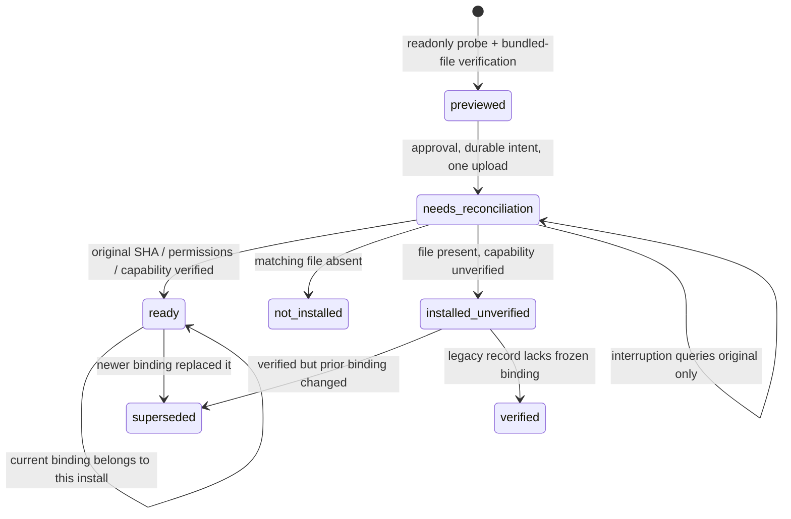

# SSH remote control and reconciliation after disconnect

[简体中文 (canonical)](remote.md) · English · [Documentation](index.en.md)

The App uses system OpenSSH through Rust native `remote_request`, **without Python on the controller**. Targets need the standalone Rust lintel runner and existing OpenSSH service, not Node/desktop runtime. User OpenSSH configuration/system agent owns keys; Lintel copies no keys and opens no public management port.

Optional `platform/ssh/lintel_ssh.py` remains a Python 3.10+ stdlib-only CLI for independent callers; desktop neither starts nor depends on it. Both send finite operations only. Desktop has fixed probe/upload/verification scripts, never frontend-supplied commands/URLs/binary paths/scripts.

## Preparation and host registration

Targets need executable lintel: noninteractive PATH works directly, or Linux x86_64/arm64 can use App installation below. Register/connect itself installs nothing; installation needs separate concrete preview/approval. Bundled binaries are development candidates; SHA-256 proves bundled/uploaded byte agreement, not formal signing/source authentication.

Desktop statically imports literal Host aliases from current-user SSH config or accepts manual aliases. Import runs no ssh -G/Match exec/ProxyCommand and expands no Include/wildcards; ignored directive types are disclosed, without claiming complete inventory. Aliases start alphanumeric, contain only alphanumeric/dot/underscore/hyphen, ≤128 bytes; no user@host/options/spaces/shell. Real OpenSSH resolves selected alias's HostName/IdentityFile/Include, but fixed ProxyCommand=none/RemoteCommand=none/PermitLocalCommand=no disable those local commands. Exception: user-config Match exec still runs locally during OpenSSH parsing, because OpenSSH cannot keep config while skipping Match exec. This is existing user configuration behavior, not a Lintel remote command; hosts unable to accept it should first adjust their config themselves.

Registration saves alias only. Explicit connect retrieves target environments/capabilities. Paths/plans always belong to that host; Mac display data never authorizes remote deletion. Target core validates both preview and execution.

Remove host changes only Lintel registry, never SSH config/known_hosts/remote files or accepted tasks. Durable tasks/deduplication remain in hosts.tasks with original plan_id query. Reregistering never reruns old jobs.

Latest-result/original-record query uses reconnect; manually entered IDs/CLI remote job use readonly job lookup. Existing task records use frozen runners despite alias upgrades. Unknown IDs query current runner without submission/deduplication records; querying an unsubmitted plan does not consume submission eligibility. Explicit reconnect without record first pins current digest/query-only intent. Legacy unbound records retain PATH lookup. Accepted/uncertain records are never erased to retry.

Verify host keys through a trusted user process first. StrictHostKeyChecking=yes/UpdateHostKeys=no never accepts first keys/changes or updates known_hosts. Resolve failures with your SSH tools, never disable strict checking.

## Preparing Linux runners in the App

1. Register a system-SSH-verified alias, choose Check and prepare runner. Fixed readonly script reads OS/CPU/UID/home/machine-id, tools/PATH runner, never Claude files.
2. Review system/user/bundled version/bytes/impact, with destination/SHA-256 expandable. Only Linux x86_64/aarch64 (arm64); missing tools/machine-id gives limits.
3. Approve this runner. App uploads local static musl ELF, with no remote downloads/compilation/Rust/Node/Python/sudo.
4. Install as current SSH user at `$HOME/.local/share/lintel/runners/<sha256>/lintel`, mode 700. UID 0 shows root. Discovery/management belongs to that user; select another user's alias if they run Claude. Missing current-user PATH does not prove other users lack Claude. Storage must be owned with no path symlinks; reuse existing bytes only with matching execution permissions, otherwise preserve conflicts. No PATH/rc/sshd/services/Claude edits; old versions retained.
5. After SHA/executable checks, real discover confirms detached_submission before alias binding. Then Connect and manage. Isolated VM logout/cgroup/reboot reconciliation passed below, separate from production VPS; no general post-logout survival promise.

The card shows status/one primary action, with details expandable. Installation persists across windows/restarts; alias removal preserves records/files.

Persist intent before any upload. Lost reply/deadline/interruption: reconcile original installation, probing original SHA/permissions/capabilities without upload. Unresolved installations prevent second upload previews; repeated install_runner only queries. Proven not-installed permits a new preview. Historical activated queries never roll back newer bindings. New tasks pin runner digest; legacy tasks retain PATH. App binding does not alter optional Python PATH behavior.



Preview approval freezes previous_binding `{digest,install_id}` or none. Under alias install lock, install_runner rechecks unresolved installs before intent; install_reconciliation_required diagnostics retain alias/install_id for direct reconciliation. Earlier parallel previews cannot bypass. Activation requires unchanged prior binding; newer records yield superseded without changing current runner. Equal digest/different install ID is a different generation. Unactivated legacy records without binding return verified/unbound; old previews stale_install_binding require preview. Current-binding queries return ready; records show last observation until requery. Task pins/no-replay remain.

<a id="prepare-app-resources"></a>
### Preparing bundled App resources

Build hosts need Rust targets/static-ELF linkers; installed [cargo-zigbuild](https://github.com/rust-cross/cargo-zigbuild)/Zig can cross-compile. From root:

```sh
rustup target add x86_64-unknown-linux-musl aarch64-unknown-linux-musl
cargo zigbuild --locked --release -p lintel-runner --bin lintel \
  --target x86_64-unknown-linux-musl --target aarch64-unknown-linux-musl
node apps/desktop/scripts/prepare-remote-runners.mjs
cd apps/desktop
npm run desktop:build
```

Packager requires both architectures, verifies ELF/no dynamic loader, generates version/protocol/bytes/SHA manifest. Ignored resources package as remote-runners. Without resources, local/PATH use remains but install returns bundle_unavailable. Static/resource checks do not prove Linux execution.

Standalone candidates also carry both runners beside executable at bin/remote-runners; see [Agent CLI](agents.en.md). Same controller, without automatic connection/install.

## Preparing a target runner from source

This is a user-run procedure, **never automatic App installation**. Review selected source. Build for target Linux OS/CPU or compatible Linux build host. Mac executables cannot simply run on Linux; arm64 App build proves no Linux runtime.

Needs Rust stable/platform linker, no Node/Tauri/WebKitGTK. From root:

```sh
uname -s
uname -m
rustc -vV
cargo build --locked --release -p lintel-runner --bin lintel
./target/release/lintel --help
```

uname identifies OS/CPU; rustc host identifies toolchain. [Manifest](../apps/runner/Cargo.toml) package lintel-runner/bin lintel outputs target/release/lintel unless target directory/triple overridden. Help must run; version --json checks version/protocol, capabilities --json static catalog. Prefer exact executable via [installation](agents.en.md#install-version).

Install into a new selected version directory retaining old executable/state/IDs, never overwrite existing lintel. PATH remains compatibility; new version paths need explicit caller selection. Its bin must be visible to **that account's noninteractive SSH PATH**, not just an interactive export. Persistent configuration belongs to login-shell/sshd conventions; never disable host checks or print startup debug to stdout.

From controller terminal replace synthetic-host with verified alias. First resolves noninteractive PATH, second runs help; neither submits/accepts keys:

```sh
ssh -T -oBatchMode=yes -oStrictHostKeyChecking=yes -oUpdateHostKeys=no \
  -oPermitLocalCommand=no -oClearAllForwardings=yes -oRequestTTY=no \
  -oConnectTimeout=10 -oServerAliveInterval=15 -oServerAliveCountMax=2 \
  synthetic-host 'command -v lintel'
ssh -T -oBatchMode=yes -oStrictHostKeyChecking=yes -oUpdateHostKeys=no \
  -oPermitLocalCommand=no -oClearAllForwardings=yes -oRequestTTY=no \
  -oConnectTimeout=10 -oServerAliveInterval=15 -oServerAliveCountMax=2 \
  synthetic-host lintel --help
```

No path: fix SSH PATH. Unexpected path: check collisions/old versions. Correct path/help failure: permissions/CPU/format/loader/dependencies. Then connect for real discover. Build/install/PATH/real-task acceptance are separate.

## Opening remote sessions from the App

Select host/environment, Open Claude in Launch and sources or completed receipt, enter independent project cwd. plan_launch freezes environment/root/cwd/static client/mode; approve request_id/exact hash before Terminal. Root is not automatically cwd; archive/import/rebuild never auto-launch.

Terminal uses strict fixed SSH/PTY and frozen runner launch_request ID HASH or resume_request ID HASH. Local script contains only finite alias/validated UUID/hash/local runner binding; remote root/cwd/executable never enter local shell. Remote core rechecks identity and persists intent before first attempt.

Controller persists original launch ID/runner/one-attempt intent before opening. Repeats/uncertainty/reopen query launch_query, never another window. Records → Session launch records hands same ID to Agent. Alias removal/upgrades preserve query version. Even planned after unsent Terminal request is not replay permission; inspect the opened terminal/original request.

Archive/plan_resume passphrases use finite stdin only. Remote execution reenters passphrase without echo in Terminal, never script/argv/environment/launch records. Static version/transcript determines support; unsupported still permits reading/context/new sessions. Supported resume uses private 0600 copy and --resume ABSOLUTE_COPY --fork-session, preserving ciphertext/original bytes. It proves no authentication/model receipt/old-session inactivity; client may reread current hooks/MCP/project/config.

Legacy launch/lintel launch ENV_ID retains readonly launch_context/root-as-cwd. New App uses approved cwd. Interactive starts and detached mutation records never impersonate each other's accepted receipts.

Claude follows PATH then current-user official native ~/.local/bin/claude, no rc/other users/version execution; [official setup](https://code.claude.com/docs/en/setup#auto-updates). Missing gives executable_missing without installation/login. launch_requested is Terminal acceptance; check login/session there. No prompt/passphrase/model requests or automatic old-session restart. SSH loss ends interactive sessions; mutations use durable submit/query. Linux TUI o/direct lintel launch needs stdin/stdout TTY/exactly one ID, with no local-proxy-as-remote claim.

## Fixed requests and native API

Bound dedicated runner path serves request/submit; unbound uses PATH lintel request. Submit stdin still command execute. Ordinary environment/path/approval/passphrases use stdin only, never remote argv. [Protocol (Chinese)](../contracts/protocol.md) retains the transport contract.

JSON/upload SSH fixes BatchMode=yes, PermitLocalCommand=no, ProxyCommand=none, RemoteCommand=none, ClearAllForwardings=yes, no TTY and bounded connect/keepalive. JSON stdin/stdout ≤2 MiB, upload ≤32 MiB, total deadline 60 seconds; runner has narrower bounds. Concurrent nonblocking stdout/stderr drains even beyond retained stderr, preventing deadlock. Diagnostics display locally only, never journals. Disconnect/incomplete/oversize gives transport_unknown. Valid nonzero runner envelopes retain code/message with optional diagnostics, without automatic execution retry.

remote_request({ payload }) returns one `{ok:true,data:...}` / `{ok:false,error:{code,message,diagnostic?}}` layer, preserving code/message.

| payload.op | Other fields | data / behavior |
| --- | --- | --- |
| aliases | none | aliases/ignored/coverage, static/no connection |
| hosts | none | hosts alias, tasks alias/plan_id/lookup_id/status/optional runner_digest, installations; all durable records including removed hosts, no connection |
| add_host | alias | alias; durable/idempotent/no connection |
| remove_host | alias | alias/removed bool; registry only, repeat false/no connection |
| prepare_runner | alias | readonly probe/persist preview; install_id/alias/probe/bundle/destination/approval/effects/status |
| install_runner | alias/install_id/approval | exact approval/rechecks/one upload/verified binding; repeat query-only |
| query_install | alias/install_id | original query, removed host supported/no upload |
| launch | alias/environment_id | readonly context then fixed Terminal/PTY/pinned runner launch id; launch_requested/message, no proxy/prompt/commands/paths |
| launch_request | alias/request_id/approval | approved original plan_launch, durable attempt then Terminal/PTY; repeat query |
| resume_request | alias/request_id/approval | approved original plan_resume, no-echo Terminal passphrase/original bytes; repeat query |
| launch_query | alias/request_id | readonly original/pinned runner, including removed aliases |
| launches | alias | local metadata only/no SSH/client; live query separate |
| connect | alias | discover environments/capabilities |
| request | alias/request | allowed core data without nested envelope |
| execute | alias/plan_id/approval, optional archive_passphrase | one submit/durable receipt; repeat original query |
| reconnect | alias/plan_id | saved lookup Receipt, removed original supported, never executes |

Connect/preview/upload/ordinary request/execute need registered alias. Removed aliases permit only persisted original reconnect/request.job/query_install/launch_query; other requests still registered. Strict allowed requests:

- discover/inspect/inspect_components/work_preflight/work_inventory/register/create_environment;
- network_inspect/network_probe/plan_network_ipv6/plan_network_restore, executed remotely with remote loopback, not App channel; Linux changes unsupported, observation/tests available;
- plan_policy/plan_reset/plan_archive/plan_preserve/plan_cleanup/plan_restore/plan_import/plan_launch/plan_resume;
- cleanup_inspect/auth_probe/archive_inspect/archive_read/session_read/service_inspect/plan_service_quiesce/plan_service_resume;
- jobs/job/drift/accept_drift/reactivate_environment/export_support.

Fields match core; unknown/shell/generic-file operations refuse. Ordinary request cannot bypass execute intent. Archive text returns only explicit reader requests, never task/diagnostics; passphrases only stdin. Terminal/service owners validate separately, without arbitrary commands/general installs/enforcement. Components/preflight/inventory readonly target operations share selected_paths schema; exact plans use submit. Invalid paths/categories/later-page missing digest refuse before SSH. Old support errors never widen to whole categories.

## Connection errors and local diagnostics

Claude alone is insufficient; noninteractive **Lintel runner** is required. runner_missing explains without auto-install. Optional diagnostic example (the current raw diagnostic prose is Chinese):

```json
{
  "stage": "ssh",
  "reason": "connection_refused",
  "summary": "目标拒绝 SSH 连接。",
  "next_steps": ["核对 SSH 端口及远端 sshd 是否在监听。"],
  "command": "/usr/bin/ssh -T -oBatchMode=yes -oStrictHostKeyChecking=yes -oUpdateHostKeys=no -oPermitLocalCommand=no -oProxyCommand=none -oRemoteCommand=none -oClearAllForwardings=yes -oRequestTTY=no -oConnectTimeout=10 -oServerAliveInterval=15 -oServerAliveCountMax=2 synthetic-host 'command -v lintel'",
  "exit_code": 255,
  "stderr_excerpt": "ssh: connect to host synthetic.invalid port 22: Connection refused",
  "stderr_truncated": false,
  "submission_uncertain": false
}
```

Stages local/ssh/runner/response. Copyable diagnostic command uses validated alias/same strict checks/BatchMode/no forwards and readonly command -v lintel, with no stdin/approval/passphrase/submit/replay. Unknown exit_code omitted.

| Stage | reason | Inspect |
| --- | --- | --- |
| local | ssh_unavailable / pipe_error | SSH existence/permissions/local pipe resources |
| ssh | dns / timeout / connection_refused / network_unreachable | HostName/network/VPN/routes/firewall/port/sshd |
| ssh | authentication_failed | User/IdentityFile/agent; BatchMode has no password dialog |
| ssh | host_key_changed / host_key_unknown / host_key_verification_failed | Trusted identity verification, never disabling strict checks |
| ssh | config_invalid / ssh_unknown | Config or insufficient error evidence |
| runner | runner_missing / runner_not_executable / abnormal_exit | PATH/permissions/architecture/loader/version/exit |
| runner | runner_rejected | Original code/message retained |
| response | invalid_json / protocol_invalid / output_limit / deadline | Welcome stdout/protocol-version/bounds/total wait |

Controller sets C locale and classifies observed text/status only, retaining unknowns. deadline means total wait exceeded, not necessarily network timeout. Stderr retention ≤64 KiB, display ≤4096 bytes on UTF8 boundaries, removing ANSI/terminal/directional controls. All ordinary stdin string values/JSON escapes are redacted; approval/passphrase requests omit stderr entirely. stderr_truncated signals collection/display truncation. Residual SSH paths/users stay local, never persisted/uploaded.

Read failures give troubleshooting; uncertain submit keeps ID/query-only. Query failure never changes job/resubmits. Runner query errors preserve reconciliation_required plus original code/message/diagnostic. submission_uncertain describes this request's mutation uncertainty; false on query does not prove original success.

## Durable intent, acceptance and recovery

Controller state remote/hosts.json and tasks/<alias>/<plan-id>.json uses core LINTEL_STATE_DIR/platform defaults, 0700/0600, atomic replacement/file-parent fsync. Existing directories must be real/current-owned. Stable locks serialize alias/plan submissions.

1. Persist plan_id/lookup_id/submission_unknown before SSH, without approval/passphrase/remote paths/settings/full receipt.
2. At most one submit per local record. Runner ACK requires durable accepted journal, never merely stdin. discover describes detached support.
3. Only valid matching plan_id/id envelopes update observed state. Accepted differs from completed; target journal owns results.
4. Lost ACK/deadline/disconnect/reopen/repeats query original. hosts.tasks restores pending UI. Query → full receipt/recovery readonly verifies original host/environment; separate settings/service approvals remain. Removed aliases query-only until reregister. Closing query panels discards late reopen.
5. Unavailable job gives reconciliation_required, never proof of no effects. Inspect target journal/state; do not erase records to unlock execute. New plans follow resolved facts.

Local intent never proves remote acceptance. Even failure before send retains conservative query, never assumes no effects.

supervisor.rs owns worker hosting; core owns journal. Readonly selection: systemd PID1 + already-root → system transient; nonroot preexisting Linger=yes/exact-UID bus → user transient; macOS/non-systemd/ineligible → setsid without logout guarantee. Units derive original UUID, Restart=no, no daemon/sudo/linger/PAM edits. Private stdin frame preserves caller auth/proxy/cwd without D-Bus/argv/disk/receipt values; request/passphrase remains stdin, passphrase never environment. Worker verifies actual cgroup, core persists execution before ACK. Uncertain manager never falls back to second launch. UI explains and expands; old receipts invent no facts.

Disconnect/completion/reboot are separate. Transients do not promise reboot continuation; uncertainty/conflicts use original reconciliation. Real hosts require [G03/J01–J10 (Chinese)](ACCEPTANCE.md), never user-bus inference.

## Custom remote policies

App/Python accept finite custom_settings/custom; [core](core.en.md) owns fields/actions, JSON stdin only. App uses remote supported_presets; old custom disabled until reviewed runner update/recheck. Old tasks keep pins. Python supports declared trusted_devices/preset release_settings with exact hash/durable execute.

## Exact remote service pause

Cleanup recipes expose manager/full unit/readonly binding inspection, then separate approved persistent blocker/load/stop. Cleanup separately approves and refuses recognized bindings without live hold, even stopped checkbox. Restore previews original job/removes owned hold/restores original state; edits preserve blocker/config. Submit/query-only, already-root for system, no sudo/login/linger/supervisor changes. [Services](services.en.md) has conditions/JSON; older runners show limits/update first.

## Optional Python CLI

Static import/request/one submit/query remain. Synthetic examples actually connect and require authorized remote scope:

```sh
python3 platform/ssh/lintel_ssh.py aliases --config path/to/synthetic-ssh-config
printf '%s\n' '{"command":"discover"}' | python3 platform/ssh/lintel_ssh.py request synthetic-host
printf '%s\n' '{"command":"plan_policy","environment_id":"00000000-0000-4000-8000-000000000001","preset":"reduce","keep_remote_control":true}' | python3 platform/ssh/lintel_ssh.py request synthetic-host
python3 platform/ssh/lintel_ssh.py execute synthetic-host --plan-id 00000000-0000-4000-8000-000000000002 --approval exact-remote-plan-hash
python3 platform/ssh/lintel_ssh.py reconnect synthetic-host --plan-id 00000000-0000-4000-8000-000000000002
```

Python retains discarded stderr; structured diagnostics/remove API are native. Its request subset: discover/inspect/plan_policy/plan_reset/plan_restore/service_inspect/plan_service_quiesce/plan_service_resume/jobs/job/drift/export_support. App cleanup/archive uses Rust. Python default .local/state/lintel/ssh-controller or --state-dir is separate; target plan/job remains execution authority.

--ask-archive-passphrase uses no-echo TTY, never argv/history; impossible safe echo control refuses. IDs/hash come from runner:

```sh
python3 platform/ssh/lintel_ssh.py execute synthetic-host --plan-id 00000000-0000-4000-8000-000000000002 --approval exact-remote-plan-hash --ask-archive-passphrase
```

Importable API: list_aliases(Path), Controller(state_dir).request(alias,payload), .execute(alias,plan_id,approval,archive_passphrase=None), .reconnect(alias,plan_id). Errors share envelope; no install/automatic replay.

## Synthetic verification

```sh
cargo test -p lintel-remote
python3 -m unittest discover -s platform/ssh/tests -v
```

Temporary homes/state/fake SSH only; no hosts/credentials/known_hosts. Native tests cover persistence/static aliases/strict argv/stdin isolation/intent-before-SSH/single concurrent submit/lost-ACK recovery/missing-mismatched receipt/no passphrase persistence/deadline-output bounds/cleanup-archive fields/removal-preserved dedupe/removed queries/error classes/concurrent stderr drain/control cleanup/redaction/readonly diagnostics/query-error retention. Python checks CLI/passphrase/fixed submit/no-replay. They prove transport/recovery, not deployment/VPS survival/service isolation/full G03.

Independent linux-vm-runtime provisions QEMU/inert services/temporary SSH users for real systemd/PAM/logout/cgroup/reboot and service prepare/recover. Historical clean 8c9d85c setsid died under KillUserProcesses=no and yes; original query needs_reconciliation without reexecute.

Clean 7a05291 [CI37216354079](https://github.com/IndelibleVivi/lintel-cc/actions/runs/37216354079) passed strict KillUserProcesses=yes: already-root system/existing-linger user managers continued after original PAM logout and completed the same policy job after synthetic barrier release; cgroup/receipt matched. Ineligible setsid died and reconciled. Real reboot yielded repeated same original needs_reconciliation for system/setsid accepted jobs without resubmit. Shared-auth fixtures retained environment/rejected scope changes before accept, with no logout/synthetic credential deletion/env persistence. Service pause/neighbor/edit-conflict/restore/reboot loaded hold passed. [Verification (Chinese)](verification.md)/[current state (Chinese)](current-state.md) own conditions/image/disposal/evidence; production/full G03 incomplete.

## Shared GUI/CLI ownership

crates/remote is the sole finite SSH/intent/registry/binding/install/query controller. Desktop remote.rs locates same-source App resources/adapts async; lintel remote uses the same public control. Static operations/describe/schema read no HOME/state/SSH. Core schemas share crates/operations with transport-specific sets/unit/text limits. [Agent SSH](agents.en.md#ssh-controller) covers aliases/hosts/inspect/request/submit/job/stdin/resources. Legacy Python subset retains callers; Rust is canonical for new features. Separate controller deduplication means never resend uncertain jobs across them.

archive_path/output_path belong to the **remote host**. Explicit ciphertext transfer precedes target read/preview/import; see [work](operator-guide.en.md#work). No generic upload/download endpoint; install uploads only frozen canonical static resources.
